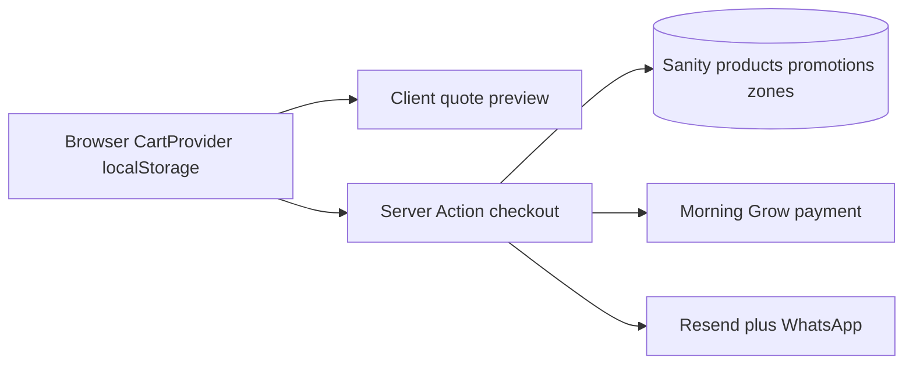

# PROJECT_BRIEF — תנא משקאות

מסמך זיכרון הפרויקט לפי סקריפט מודול א׳. מעודכן בסוף כל מודול.  
**אין לשאול שאלות שכבר נענו כאן.**

אתר חי: https://tene-mashkaot.vercel.app  
ריפו: https://github.com/wkhn091-del/tene-mashkaot.git  
תיקיית עבודה: `tene-mashkaot/` (git נפרד)

---

## החלטות כיוון (מודול א׳)

| החלטה | ערך נעול | תאריך |
|--------|----------|--------|
| סטטוס מול הסקריפט | **ביקורת ומילוי פערים על הקיים** — לא ריסטארט מודול א׳ מאפס | 2026-10-27 |
| Tier | **Tier 3** — React Three Fiber Hero (לא Image Sequence, לא ירידה ל-Tier 1) | 2026-10-27 |
| אזור אישי / Login (ב׳/ג׳) | **נעול קל:** מעקב הזמנה (מספר+טלפון) + הזמן שוב + היסטוריה במכשיר; בלי Clerk; Guest checkout נשאר | 2026-10-28 |
| כפתורים מיותרים | לשאול לפני הסרה; להסיר רק אחרי אישור מפורש | כלל משתמש |
| שלב 2 ארכיטקטורה | **מאושר** — ליבה קיימת; בלי בנייה מחדש; מילוי פערים רק באישור מפורש | 2026-10-27 |
| מודול א׳ (תחקיר+אישור) | **סגור** — א׳-2 / א׳-3 / 3D pipeline = קיים מספיק | 2026-10-27 |
| סקריפט 1 | **סומן כהושלם** ע״י הלקוח | 2026-10-28 |
| חבילת CRO המרות | באנר הזמנות חי, Hero+WA, endsAt, funnel ריק, ביקורות מוקדמות | 2026-10-28 |
| חבילת סגירה | OOS→WA, פס מתנה בסל, משלוח חינם בעמוד מוצר | 2026-10-28 |

---

## מודול א׳ — קבוצה 1: מותג ותשתית (נעול)

| שדה | ערך |
|-----|------|
| שם העסק | תנא משקאות / Tene Mashkaot |
| סלוגן | חוויה של לגימה |
| כתובת | שמעון בן שטח 4, אלעד |
| טלפון / וואטסאפ | 053-5467863 / 972535467863 |
| כשרות | בהשגחת בד״ץ אלעד |
| צבעי מותג | Wine `#140508`–`#933a4a`, Gold `#d4a95a`, Cream `#f7f1e6` (`src/app/globals.css`) |
| פונטים | Display: Suez One; Text: Heebo (self-hosted) |
| שפות | עברית (ברירת מחדל) + אנגלית, RTL דרך next-intl |
| סטאק | Next.js App Router, Tailwind v4, Sanity, R3F |
| סטייט עגלה | `CartProvider` (Context) + localStorage — **לא** Zustand לעגלה (Zustand רק כתלות R3F) |
| CMS | Sanity Studio; מוצרים לפי קטגוריה; slug אוטומטי |
| תשלומים | Morning/Grow + מזומן בעת מסירה |
| צד־שלישי | Turnstile, Resend, Upstash rate-limit, WhatsApp Cloud, GA4 + Meta Pixel (אחרי consent), Sentry |
| גיל 18 | Age gate בכל כניסה חדשה (session cookie `tene_age_ok`) |
| 3D | 4 מודלים CC BY 4.0; קרדיט מלא בעמוד תנאים; `MODEL_URL` v=6 |

### מה כבר בוצע (ליבה)
- חנות, מוצר, עגלה, צ׳קאאוט, הזמנות, מבצעים, אזורי משלוח
- Hero R3F + פוסטר סטטי + lazy canvas; autoplay במובייל ללא pin ארוך; pin קצר בדסקטופ (200svh)
- משפטי / נגישות / אזהרת אלכוהול
- אבטחה: Zod, Turnstile, rate-limit, מחירים בשרת, `server-only` לסודות
- CRO חלקי: חיפוש+מיון, upsell בעגלה, מחיר ל־100 מ״ל, BreadcrumbList, קישור Google Reviews

### פערים מול הסקריפט (מתועדים — לא לבנות בלי אישור מודול)
- אין Lenis / Magnetic cursor / SplitText מלא (א׳-3)
- R3F עם אורות דינמיים — לא baked lightmaps Path C; לא Image Sequence Path A
- אין Faceted Search מלא (יש חיפוש+מיון לפי מחיר)
- ~~אין "האתר זוכר"~~ — **בוצע:** חיפוש אחרון + צפיתם לאחרונה (localStorage)
- ~~אין KPIs + מפת חום~~ — **בוצע:** Clarity + רשימת 5 KPIs (דורש Project ID ב־env)
- תוכן: האתר החי עלול להיות ריק ממוצרים עד העלאה בסטודיו

### שאלות פתוחות (לא חוסמות ארכיטקטורה)
1. באנר עוגיות במובייל — **בוצע** (פריסה קומפקטית + `bodyShort`)

---

## מודול א׳ — קבוצה 2: לוגיקת E-commerce (נעול)

**אישור לקוח 2026-10-27:** נשארים על המודל הקיים. אין הרחבת וריאציות / Faceted / 1+1 / מלאי מספרי בשלב זה.

| שאלה | החלטה נעולה |
|------|-------------|
| וריאציות מחיר | מוצר אחד = מחיר אחד; אופציות מארז (סרט/הקדשה) ובלונים (צבע/טקסט) נשארות כפי שהן |
| סינון בחנות | קטגוריה + חיפוש + מיון מחיר — **בלי** Faceted Search חדש |
| מבצעים | percentOff, fixedPrice, giftThreshold, coupon בלבד — **בלי** 1+1 / BOGO |
| מלאי | `inStock` בוליאני בלבד |
| קופונים | נשארים במודל Sanity (מוכנים לשימוש); אין דרישה חדשה מעבר לקיים |

**נימוק מידתיות (סעיף 9 בסקריפט):** חנות שכונתית באלעד — מורכבות SKU/Faceted/מלאי מספרי לא מצדיקה עלות תחזוקה כרגע. אם ישתנה — לעדכן טבלה זו לפני קוד.

---

## מודול א׳ — קבוצה 3: אימרסיב ונכסים (נעול)

**אישור לקוח 2026-10-27:** נשארים על ה־Hero הקיים ב־R3F. בלי מעבר ל־Image Sequence, בלי shaders במעברי עמוד, בלי נכסים חדשים מעבר למודלים המורשים שכבר באתר. תקציב משקל GLB: עד ~2MB לנכס Hero (כרגע מתחת לסף).

| שאלה | החלטה נעולה |
|------|-------------|
| רינדור | Tier 3 R3F קיים (פוסטר → lazy canvas); לא Path A Sequence |
| Shaders / distortion | לא — רק חוויית ה־Hero |
| נכסים | רק המודלים המורשים הקיימים (CC BY 4.0 × 4) |
| תקציב משקל | תקרת ~2MB ל־GLB Hero מאושרת |

---

## מודול א׳ — קבוצה 4: משפטי ורגולציה ישראלית (נעול)

**אישור לקוח 2026-10-27:** הטקסטים וההגדרות המשפטיות הקיימים מאושרים. בלי שינוי מדיניות ביטול / נגישות / פרטי עוסק בשלב התחקיר. עדכוני תוכן נקודתיים (ח.פ, נגישות פיזית) יטופלו ב־CMS אם יידרשו מאוחר יותר — לא חוסמים את הארכיטקטורה.

| שאלה | החלטה נעולה |
|------|-------------|
| פרטי עוסק | נשארים כפי שב־defaults / siteSettings / Morning |
| נגישות פיזית | להשאיר את הקיים בהצהרה |
| ביטול עסקה | הטקסט הקיים (14 יום + חריגים) מאושר |
| חשבונית | זרימת Morning הקיימת מאושרת |

---

## מודול א׳ — קבוצה 5: אבטחה, התראות ו־API (נעול)

**אישור לקוח 2026-10-27:** נשארים על התשתית הקיימת.

| שאלה | החלטה נעולה |
|------|-------------|
| התראות הזמנה | מייל (Resend) + WhatsApp לחנות — כמו היום |
| אזורי משלוח | כפי שב־CMS (אלעד חינם כברירת מחדל); עדכוני ערים = תוכן CMS בלבד |
| Cutoff אותו־יום | `sameDayBufferMinutes` + הגדרות `deliverySettings` הקיימות |
| CSP / צד־שלישי | הרשימה הקיימת מאושרת (Sanity, Turnstile, Morning/Grow, GA4, Meta, Sentry, Resend, Upstash) |
| מפות חום / KPI | **בוצע בקוד:** Clarity דרך `NEXT_PUBLIC_CLARITY_PROJECT_ID` + 5 KPIs ב־DEPLOYMENT / BRIEF; דורש מזהה ב־Vercel |

---

## שלב 2 — סיכום ארכיטקטורה (מאושר 2026-10-27)

**אישור לקוח:** הארכיטקטורה הקיימת מאושרת. מודול א׳ נסגר בלי בנייה מחדש.  
א׳-2 / א׳-3 / מודול 3D = קיים מספיק (ללא סבב עיצוב/תנועה/pipeline חדש).  
מילוי פערים או מודול ב׳/ג׳ — רק אחרי בקשה מפורשת.

### 1) סכמות Sanity

| Document | תפקיד |
|----------|--------|
| `product` | מוצר: תמונות, כותרת, מחיר, קטגוריה, inStock, featured, מפרט לפי kind, אופציות gift/balloons, slug |
| `category` | קטגוריה + `kind` |
| `promotion` | percentOff / fixedPrice / giftThreshold / coupon |
| `order` | הזמנה (קריאה בסטודו; נוצרת מהשרת) |
| `deliveryZone` | עיר, דמי משלוח, מינימום, freeAbove |
| `deliverySettings` | slots, buffers, שבת, איסוף |
| `siteSettings` | מותג, קשר, שעות, משפטי, קרדיט מודלים נוסף |
| `legalPage` | override לטקסטים מובנים |
| `eventInquiry` | פניות אירועים |

### 2) ארכיטקטורת עגלה וצ׳קאאוט

- **קליינט:** מזהי מוצר + כמות + אופציות התאמה בלבד (`CartProvider`). אין מחירי אמת כמקור אמת.
- **שרת:** `checkout` טוען מוצרים/מבצעים/אזורים מ־Sanity, מחשב מחירים ב־`pricing.ts`, Zod + Turnstile, יוצר `order`, מעביר לתשלום או מזומן, `notifyNewOrder`.
- **Guest first:** אין חובת login.

### 3) מפת אבטחה

| שכבה | מימוש |
|------|--------|
| Server-side truth | מחיר, מבצע, מלאי, דמי משלוח — רק בשרת |
| Validation | Zod על כל קלט צ׳קאאוט / אירועים |
| Bot | Cloudflare Turnstile |
| Rate limit | Upstash |
| Secrets | `server-only` / env; לא בבאנדל קליינט |
| GROQ | פרמטרים בלבד |
| CSP | nonce ב־`proxy.ts` + headers ב־`next.config.ts` |
| Webhooks | Morning notify + secret; Sanity paid webhook |
| Privacy | Sentry בלי PII; analytics אחרי consent |
| Age | session cookie; שאלה בכל כניסה חדשה |

### 4) מטריצת לוגיקה עסקית (כללים → בדיקות Unit עתידיות)

| מזהה | כלל | בדיקה עתידית |
|------|-----|----------------|
| P1 | מחיר שורה = מחיר Sanity × כמות אחרי מבצע בתוקף | מוצר עם percentOff → מחיר סופי צפוי |
| P2 | מבצע מחוץ לחלון זמן / `active:false` לא חל | endsAt בעבר → מחיר מלא |
| P3 | קופון לא חוקי / מתחת ל־minSubtotal נדחה | קוד שגוי → שגיאת validation |
| P4 | משלוח אלעד = 0 לפי ברירת מחדל zone | עיר אלעד → deliveryFee 0 |
| P5 | איסוף לא זמין כש־`pickupEnabled:false` | checkout pickup → error |
| P6 | הזמנה חסומה בשבת לפי שעות + openAfterShabbat | now בשבת → `shabbat` |
| P7 | מוצר `inStock:false` לא ניתן לרכישה | הוספה/checkout → דחייה |
| P8 | leadTimeHours של פריט דוחה סלוטים | מארז 24ש → אין סלוט מיידי |
| P9 | same-day מכבד `sameDayBufferMinutes` | now+buffer אחרי סוף סלוט → אין אותו־יום |
| P10 | תשלום כרטיס בלי אימות Morning לא מסומן paid | notify מזויף → 401/דחייה |
| P11 | Age gate חוסם גלילה עד אישור | ללא cookie → overlay |
| P12 | Consent: GA4/Pixel לא נטענים לפני אישור | לפני consent → אין gtag config |

### 5) פערים מאושרים לתיעוד (לא לבנות אוטומטית)

נדחו במפורש בתחקיר או נדחו לשלב מאוחר: Faceted Search, וריאציות SKU, 1+1, מלאי מספרי, Lenis/Magnetic/SplitText מלא, Image Sequence, baked lightmaps, Login/Portal, KPIs+heatmap, "האתר זוכר".

פער תוכן (לא קוד): העלאת מוצרים אמיתיים בסטודיו.

פער UX פתוח: באנר עוגיות במובייל — לשאול לפני שינוי.

### 6) א׳-2 / א׳-3 / מודול 3D

**סטטוס:** מאושרים כ־"קיים מספיק". אין סבב ארט־דיירקשן / מנוע תנועה / החלפת pipeline 3D אלא אם הלקוח יפתח מחדש.

---

## KPIs להשקה (מדידה)

| # | מדד | כלי |
|---|-----|-----|
| 1 | הוספה לסל / צפייה במוצר | GA4 |
| 2 | התחלת קופה / סשנים עם סל | GA4 |
| 3 | הזמנות שהושלמו לשבוע | GA4 `purchase` |
| 4 | חיכוך בבאנר גיל/עוגיות | Clarity recordings |
| 5 | גלילה למובייל עד החנות אחרי Hero | Clarity scroll |

הפעלה: להגדיר `NEXT_PUBLIC_CLARITY_PROJECT_ID` (+ GA/Pixel אם עדיין ריקים) ב־Vercel ולבצע Redeploy.

---

## מודול ב׳ — אזור הזמנות קל (נעול / בבנייה)

**אישור לקוח 2026-10-28:** «תעשה מה שהכי מומלץ» → פורטל קל בלי Clerk.

| פיצ׳ר | החלטה |
|--------|--------|
| אימות | מספר הזמנה + טלפון (תשובת כישלון אחידה) |
| הזמן שוב | כן — מחירים/מלאי מחושבים בשרת בזמן החיפוש |
| היסטוריה במכשיר | כן — localStorage (מספר + טלפון מוצפן חלקית / מלא לחיפוש חוזר) |
| Login / מודול ג׳ | לא |

נתיב: `/orders` (noindex). Cache-Control: private, no-store על תשובות.

## מודול ג׳ — IAM (מושהה)
לא נפתח — נשאר Guest + מעקב קל.

---

## היסטוריית עדכונים
| תאריך | מה |
|--------|-----|
| 2026-10-27 | נעילת קבוצה 1 + כיוון Tier 3 / ביקורת פערים; פתיחת תחקיר קבוצה 2 |
| 2026-10-27 | לקוח אישר קבוצה 2 = מצב קיים; פתיחת תחקיר קבוצה 3 |
| 2026-10-27 | לקוח אישר קבוצה 3 = R3F קיים; פתיחת תחקיר קבוצה 4 |
| 2026-10-27 | לקוח אישר קבוצה 4 = משפטי קיים; פתיחת תחקיר קבוצה 5 |
| 2026-10-27 | לקוח אישר קבוצה 5; סיכום ארכיטקטורה שלב 2 ממתין לאישור |
| 2026-10-27 | לקוח אישר שלב 2; מודול א׳ סגור |
| 2026-10-27 | התחלת מילוי פערים לאט: באנר עוגיות קומפקטי במובייל |
| 2026-10-27 | האתר זוכר: חיפוש אחרון + מוצרים שנצפו |
| 2026-10-27 | מדידה: Microsoft Clarity + 5 KPIs להשקה |
| 2026-10-27 | CTA דביק במובייל (מוצר + עגלה); וואטסאפ/נגישות מורמים מעליו |
| 2026-10-27 | CTA דביק גם בקופה (סיכום + שליחה) |
| 2026-10-27 | פתיחת תחקיר מודול ב׳ (פורטל קל מול Login מלא) |
| 2026-10-28 | מודול ב׳ קל: /orders + lookup + reorder + היסטוריה במכשיר |
| 2026-10-28 | חיזוק /orders: קישור בתפריט מובייל + Turnstile |
| 2026-10-28 | /orders בהדר/סל ריק; robots disallow; הסתרת וואטסאפ בעמוד |
| 2026-10-28 | חבילת CRO המרות אחרי סקריפט 1 |
| 2026-10-28 | חבילת סגירה: OOS→WA + progress מתנה + trust משלוח במוצר |
